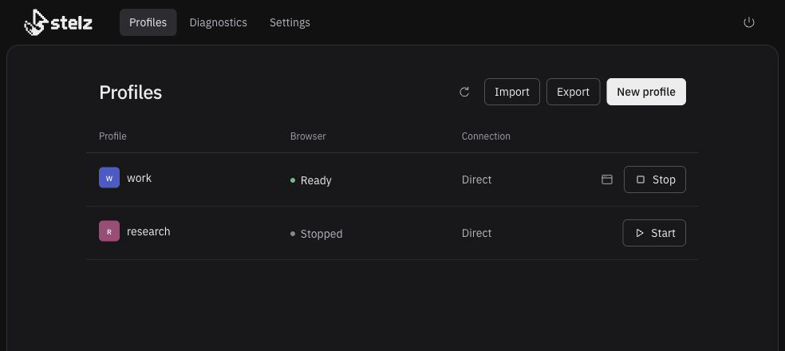

<h1>
  <picture>
    <source media="(prefers-color-scheme: dark)" srcset="assets/brand/stelz-logo-full-dark.svg">
    <source media="(prefers-color-scheme: light)" srcset="assets/brand/stelz-logo-full.svg">
    
  </picture>
</h1>

[](https://www.npmjs.com/package/stelz)
[](https://github.com/souljorje/stelz/actions/workflows/ci.yml)
[](LICENSE)

**Stealth browser for AI agents.**

Persistent browser profiles that your existing agent can control while you watch and take over when needed.
Powered by Camoufox, with browser tools delivered through MCP.

- Keep logins and saved device settings between browser runs.
- Give each profile its own browser and optional proxy.
- Pause your agent for manual work in the same visible window.
- Run agents in separate profiles at the same time. Practical capacity depends on your machine.
- Register `stelz mcp` once. Each agent can control multiple profiles through explicit profile IDs and control handles.
- Control pages through accessibility snapshots.

Stelz manages the browsers. Your agent decides what to do.



## Quickstart

The tested desktop platform is macOS on Apple Silicon.
You need Bun ≥1.4.4, Node.js ≥24, and the paired Camoufox build.
Follow [Getting started](docs/getting-started.md) to install the prerequisites and locate or download Camoufox.
`stelz setup` requires the browser to exist already.

With those prerequisites ready:

```sh
PLAYWRIGHT_SKIP_BROWSER_DOWNLOAD=1 npm install --global stelz
stelz init
stelz setup
stelz ui --open
```

Create a profile named `work` in the UI. Leave the proxy blank for a direct connection, then select **Start**.
[Connect your agent](docs/clients.md) to use that browser.
Agents can also create direct profiles and start browsers through the shared MCP tools.
Each profile permits one browser and one controller.

## Let your agent set it up

Give a local coding agent this request:

> Follow the [agent setup guide](docs/bootstrap.md). Create or reuse profile `work`. Start its browser. Connect your browser tools. Preserve existing profiles, credentials, and client settings. Check browser control. Report anything I must complete.

## Documentation

- [Getting started](docs/getting-started.md) · [Agent setup](docs/bootstrap.md) · [Documentation index](docs/README.md)
- [Manage profiles and take over](docs/ui.md) · [Configure a proxy](docs/proxies.md)
- [Move profiles](docs/profile-transfer.md) · [Troubleshoot](docs/troubleshooting.md)
- [CLI reference](docs/cli.md) · [Configuration reference](docs/configuration.md)
- [Shared MCP tools](docs/mcp.md)

## Contribute

See [Contributing](CONTRIBUTING.md) for development and checks. Stelz uses the [MIT license](LICENSE).
