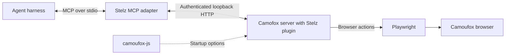

# Architecture

stelz runs persistent browser profiles independently of agent clients.
The client owns reasoning and conversation history. The service owns browser state and exclusive control.
The service needs no agent harness or LLM credentials.

## Components and request path

| Component | Responsibility |
| --- | --- |
| MCP | The Model Context Protocol advertises tools, accepts arguments, and returns results. Stelz uses standard input and output for this connection. |
| Stelz MCP adapter | Selects one profile per connection. Adds profile controls and forwards browser calls to that profile's service. |
| Camofox | The HTTP automation server. Manages tabs, resolves element references, and returns accessibility snapshots and screenshots. |
| Stelz profile plugin | Runs inside Camofox. Enforces controller ownership, serializes actions, checks network state, and preserves the original browser context. |
| Playwright | Starts and controls the browser. Performs actions such as clicks, typing, and navigation. |
| Camoufox | The Firefox-based browser executable. Implements fingerprint settings and humanized cursor movement. |
| `camoufox-js` | Prepares Camoufox startup options, including fingerprint, locale, proxy, and browser preferences. |

`camoufox-js` supplies `launchOptions()` during startup. Playwright uses those options to start the browser.
Stelz adds persistent profile handling and reuses saved device properties before browser startup.
`camoufox-js` does not define MCP tools or process agent requests.

A browser tool call passes through these steps:

1. The MCP adapter sends the tool name, arguments, and controller ID to `/local-profile/tool`.
2. The plugin checks the tool and controller, then queues the operation for that profile.
3. The plugin checks browser availability and performs any required IP check.
4. The upstream dispatcher calls the corresponding Camofox HTTP route on the same local service.
5. Camofox executes the action through Playwright. The response adapter returns text or image content to the client.

See the upstream [Camofox MCP documentation](https://github.com/jo-inc/camofox-browser/blob/master/mcp/README.md)
and [camoufox-js documentation](https://github.com/apify/camoufox-js) for their interfaces.

## Browser lifetime and controller ownership

Each active profile has a separate supervisor and Camofox server, with at most one browser instance.
Bun runs the CLI, MCP adapter, supervisor, and local UI server. Node.js runs Camofox and the profile plugin.
The supervisor runs separately from the client. Closing a chat or UI session therefore preserves the browser.
Multiple native windows and subprocesses can belong to that browser instance.

`stelz start ID` or the local UI starts a profile. MCP acquisition requires an already running profile.
Startup locks, service instance IDs, and process start records prevent competing starts from replacing an existing browser.
The service imposes no global browser or saved-profile count limit. Available system resources constrain capacity.

A controller is one MCP connection with exclusive access to a profile.
The service enforces ownership and serializes browser actions. Separate profiles can perform actions concurrently.
This keeps simultaneous clients from changing the same page during another client's task.
The selected profile ID also supplies Camofox's `userId`. Its tab group remains `default` across connections.

Release waits for queued operations and relinquishes control. Disconnect also releases control without closing pages.
After a client crash, a later acquisition can clear its controller when the client process is dead and no actions remain.
The next controller receives the same live browser state. It does not receive the previous client's reasoning or conversation history.

Pause blocks browser actions while a human uses the same window. Resume checks the required network state before actions continue.
Clients must read a fresh snapshot after resume or handoff.
Explicit stop ends the browser lifetime. Closing the browser window also stops the profile.
See [client handoff](clients.md#check-a-handoff) and [agent instructions](agents.md).

## Persistent state and fingerprints

`STELZ_HOME` selects the service directory. The current workspace, client PID, and conversation ID never select browser storage.
`profiles.json` stores profile configuration. `secrets.env` stores secret values referenced by configuration.
Existing IDs, secret references, and legacy `identities.json` data paths remain supported.
This lets different clients use the same profile without moving its data.

New profiles use native storage under `profiles/ID/browser-data/`.
Playwright starts Firefox with its persistent context, and Camofox claims that same context for browser actions.
Existing profiles without an explicit storage mode retain checkpoint storage under `storage/`.
Native mode prevents checkpoint restoration over native browser data.
Switching storage modes requires deliberate migration. Startup rejects combinations that could replace existing state with stale checkpoints.

`fingerprint.json` records selected device properties and the browser executable hash.
On restart, Stelz reuses those device properties while retaining current locale, location, and security policy.
A changed executable or invalid fingerprint record blocks startup.
Saved fingerprint configuration does not guarantee identical observable output. Earlier acceptance tests recorded varying canvas hashes.
See [persistent state](README.md#persistent-state) for the file layout and migration restrictions.

## Profile transfers

The CLI and local UI transfer profiles through versioned ZIP archives.
The manifest records profile settings, source compatibility, file sizes, and SHA-256 hashes.
Streaming reads and writes support ZIP64 without loading browser data into memory.

Export snapshots cleanly stopped profiles under the admission lock and selected lifecycle locks, acquired in profile ID order.
It releases those locks before compression. Export never stops a browser automatically.

Import checks private staging data before it changes the catalog.
It assigns unused IDs, ports, and secret references, then installs the selected batch through a durable journal.
One catalog replacement publishes the complete batch. Configuration changes and explicit starts complete pending recovery first.
Imported profiles remain stopped. Existing profile data and secret references stay unchanged.

The UI uses background transfer jobs with its existing session and origin checks.
Uploads and downloads stream through separate endpoints. An active transfer prevents UI shutdown.
Profile transfer adds no MCP tools.
See [Import and export profiles](profile-transfer.md) for compatibility, content, limits, and recovery.

## MCP tool contracts

Camofox's HTTP routes and MCP tools are separate interfaces.
An HTTP capability reaches an agent only when a tool schema, dispatcher, and response adapter expose it.
Camofox's upstream MCP adapter shares its contracts with the OpenClaw plugin.
Stelz reuses those contracts through its own MCP adapter. It does not run an OpenClaw instance.

Stelz adds the six `profile_*` tools and filters the upstream browser tool list.
It excludes `camofox_evaluate` and `camofox_import_cookies` from that list.
The supported authentication workflow pauses for human action in the existing browser.
The client reads available tools through MCP `tools/list`.

Stelz also extends `camofox_type` with per-call typing modes.
Camoufox's cursor humanization and Stelz's typing behavior are separate mechanisms.
See [typing](README.md#typing) for modes and defaults.

New browser controls must pass through the same controller, action queue, network checks, and time limit.
An upstream HTTP endpoint alone does not establish Stelz MCP support.
Extensions need checks for their contract and browser behavior while preserving existing tool calls.

### Planned browser controls

Status: planned for later implementation. These controls are not currently available through Stelz MCP.
The inventory uses the [pinned Camofox 1.18.1 server](https://github.com/jo-inc/camofox-browser/blob/39c82094013480b373df6600d44c7f036f58356e/server.js).
Each addition still requires Stelz integration and browser checks. Final tool names and arguments remain undecided.

| Planned capability | Existing upstream handler |
| --- | --- |
| Double-click | `POST /act` with `kind: "click"` and `doubleClick: true`. The current MCP click route ignores this argument. |
| Hover | `POST /act` with `kind: "hover"`. |
| Keyboard keys and shortcuts | `POST /tabs/:tabId/press`. |
| Native dropdown selection | `POST /tabs/:tabId/select`. |
| File upload | `POST /tabs/:tabId/upload`, using files inside the configured upload directory. |
| Download retrieval | `GET /tabs/:tabId/downloads`, with optional file contents. |
| Save the current PDF | `POST /tabs/:tabId/fetch-current-resource`. |
| Back, forward, and reload | `POST /tabs/:tabId/back`, `POST /tabs/:tabId/forward`, and `POST /tabs/:tabId/refresh`. |
| Wait for page readiness, text, or load state | `POST /tabs/:tabId/wait` and `POST /act` with `kind: "wait"`. |
| Scroll an element into view | `POST /act` with `kind: "scrollIntoView"`. |
| Viewport resizing | `POST /tabs/:tabId/viewport`. |
| Read links and images | `GET /tabs/:tabId/links` and `GET /tabs/:tabId/images`. |
| Structured extraction from snapshot references | `POST /tabs/:tabId/extract`. |
| Read tab statistics and session traces | `GET /tabs/:tabId/stats` and the session trace routes. |

Right-click and drag/drop are also planned. Camofox 1.18.1 has no handlers for these actions.
They require server implementation and MCP support.

Reuse existing upstream handlers where available. Preserve existing tool names, arguments, and behavior when adding optional controls.
All additions must use the controller, action queue, network checks, and time limit described above.
File operations must enforce configured path boundaries, profile ownership, and transfer size limits.
Before release, check MCP contracts, controller isolation, pause/resume, timeout behavior, and actions in a headed browser.
This plan keeps JavaScript evaluation and cookie import excluded. Human authentication continues in the same browser window.

## Failure handling and network policy

The service limits browser operations to 60 seconds.
A timeout blocks subsequent actions because the original operation may still be active.
An MCP client timeout does not cancel the service operation.
Stelz requires explicit stop and start after a blocked browser operation. It does not replay interrupted actions.
This prevents a retry from repeating a form submission or another partially completed action.

The plugin rejects replacement browsers and replacement sessions within an existing service lifetime.
Process ownership checks also distinguish stopped, unclean, and orphaned services.
Recovery requires an operator to resolve uncertain state before another start.
See [service operations](README.md#commands).

Proxy routing belongs to the browser configuration. Proxied profiles disable WebRTC and direct proxy failover.
Browser-based IP checks share the action queue and check the configured route.
A failed check blocks browser actions until a successful explicit recheck.
Successful checks have a bounded cache lifetime. Startup, resume, and explicit recheck require fresh checks.
IP checks report network health. They do not provide a host firewall or guarantee continuous IP stability.
See [network configuration](README.md#configuration) for the exact policy.

## Local UI and distribution

The React UI uses a separate local HTTP API for profile configuration, lifecycle operations, and window controls.
The UI server binds to loopback. An initial token establishes a session cookie, and API mutations require the same origin.
The Camofox service also binds to loopback and requires its profile access key.
Showing a browser window preserves its controller. Human takeover still requires pause.
Closing the UI server preserves active browsers.
See [UI operations](ui.md).

Only `packages/stelz` produces the release package. `apps/ui` remains a private workspace package.
The build copies canonical root documentation and examples into the release package.
The package includes prepared Camofox and `camoufox-js` dependencies with committed compatibility patches.
Setup checks and stages the runtime before activation. It preserves the installed Camoufox app and existing profile data.
Pinned dependencies make compatibility changes reproducible and reviewable.
See [adapter patches](camofox-patches.md) and [distribution](distribution.md).

In the source workspace, `packages/stelz/src/` separates responsibilities by directory:

| Directory | Responsibility |
| --- | --- |
| `cli/` | Command parsing and user-facing operations. |
| `profiles/` | Configuration, profile archives, catalog transactions, compatibility, and secret references. |
| `runtime/` | Process ownership, locks, lifecycle operations, and supervision. |
| `mcp/` | MCP transport, tool policy, and controller ownership. |
| `browser/` | Camofox integration, persistent contexts, fingerprints, typing, and IP checks. |
| `api/` | Local UI endpoints, service models, and transfer jobs. |

Offline tests check contracts and state transitions. Headed acceptance tests check actual browser behavior.
A build or mock test alone cannot establish persistence, proxy routing, or human takeover behavior.
See [development and testing](tests.md) for the available suites and recorded acceptance limits.
