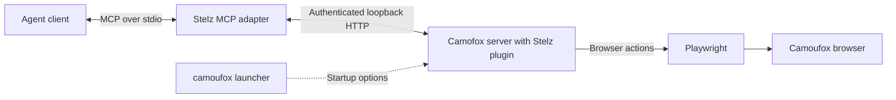

# Architecture

Stelz runs persistent browser profiles independently of agent clients.
The client owns reasoning and conversation history. The service owns browser state and exclusive control.
The service requires no agent harness or model credentials.
It contains no reasoning loop, agent framework, generic plugin framework, or fleet platform.

## Components and request path

| Component | Responsibility |
| --- | --- |
| MCP | The Model Context Protocol advertises tools, accepts arguments, and returns results over standard input and output. |
| Stelz MCP adapter | Exposes 18 fixed tools. Routes each call by profile ID and checks its control handle. |
| Camofox server | The HTTP automation server. Manages tabs, resolves element references, and returns accessibility snapshots and screenshots. |
| Stelz profile plugin | Runs inside Camofox. Enforces controller ownership, serializes actions, checks network state, and preserves the original browser context. |
| Playwright | Starts and controls the browser. Executes clicks, typing, and navigation. |
| Camoufox browser | The Firefox-based executable. Applies device settings and cursor behavior. |
| `camoufox` launcher | The official npm launcher. Prepares Camoufox startup options, including device settings, locale, proxy, and browser preferences. |

Camoufox is the browser. Camofox is the automation server.
The official `camoufox` launcher supplies `launchOptions()` before Playwright starts the browser.
Stelz adds persistent profile handling and reuses saved device properties before startup.
The launcher does not define MCP tools or process agent requests.

A browser tool call follows this path:

1. The MCP adapter checks `profileId` and `controlHandle` against that connection's current acquisition and browser lifetime.
2. It forwards the canonical browser arguments and private service control data to `/local-profile/tool`.
3. The plugin checks the tool and controller. It queues the operation for that profile.
4. The plugin checks browser availability and performs any required IP check.
5. The upstream dispatcher calls the corresponding Camofox HTTP route on the same local service.
6. Camofox executes the action through Playwright.
7. The response adapter returns text or image content to the client.

See [Camofox integration](camofox-integration.md) for pinned dependencies, compatibility patches, and setup.

## Browser lifetime and controllers

Each active profile has a separate supervisor and Camofox server, with at most one browser instance.
Bun runs the CLI, MCP adapter, supervisor, and local UI server. Node.js runs Camofox and the profile plugin.
The supervisor runs separately from the client. Closing a chat or UI session preserves the browser.
Several native windows and subprocesses can belong to that browser instance.

`profile_start({profileId})`, `stelz start ID`, or the UI starts a profile.
MCP acquisition requires an already running profile.
Startup locks, service instance IDs, and process start records prevent competing starts from replacing an existing browser.
The service imposes no global browser or saved-profile count limit. Available system resources constrain capacity.

Each client registers `stelz mcp` once. One connection can acquire multiple profiles.
Stelz has no agent identities or agent count limits.
The service permits one controller per profile. Each profile has its own action queue.
Separate profiles can execute actions concurrently, including through one connection.
Each call's profile ID also supplies Camofox's `userId`. Its tab group remains `default` across connections.

Every successful acquisition returns status and a fresh opaque public `controlHandle`.
That handle belongs to one connection, one profile, and one browser lifetime.
The adapter keeps acquisition state separately for each profile.
Status and catalog results contain controller summaries without handles.
Release, disconnect, restart, and forced operator handoff invalidate the affected control.
Clients must acquire again and use the new handle before further control calls.

Release waits for queued operations before it relinquishes control. Disconnect releases control without closing pages.
Clients must release explicitly before planned handoff.
After a client crash, acquisition can clear its controller when the client process is dead and no actions remain.
The next controller receives the same live browser state. Conversation history stays with the previous client.

Pause blocks browser actions while a human uses the same window.
Resume checks required network state before actions continue.
Clients must read a fresh snapshot after resume or handoff.
An explicit stop ends the browser lifetime. Closing the browser window also stops the profile.
See [Client handoff](../clients.md#multiple-profiles-and-handoff) and the [canonical browser skill](../../skills/stelz-browser/SKILL.md).

## Persistent state and device properties

`STELZ_HOME` selects the service directory. The workspace, client PID, and conversation ID never select browser storage.
`profiles.json` stores profile configuration. `secrets.env` stores secret values referenced by configuration.
New profiles use native Firefox storage under `profiles/ID/browser-data/`.
Playwright starts its persistent context. Camofox claims that same context for browser actions.

`fingerprint.json` records selected device properties and the browser executable hash.
On restart, Stelz reuses those properties while retaining current language, location, and security policy.
Saved device data cannot replace current add-on paths, session history, or Firefox security preferences.
WebGL2 capability follows the saved GPU properties.
A changed executable or invalid fingerprint record blocks startup. Browser changes require an explicit migration.
There is no browser-version migration command.

Saved settings do not guarantee identical observable output.
The [historical browser report](reports/browser-acceptance-2026-11.md) records varying canvas hashes and the measurement limits.
See [Configuration](../configuration.md) for service files and [Profile transfer](../profile-transfer.md) for compatibility requirements.

## Catalog and network transactions

Configuration mutations enter `prepareProfileConfiguration()` in `src/profiles/profile-configuration.ts`.
It holds `profiles/admission.lock` under `STELZ_HOME` while it completes pending recovery and the requested mutation.
Recovery checks import, catalog, and network journals in that order.
Operations that require a profile lifecycle lock acquire it after the admission lock.
Explicit start also completes pending configuration recovery before starting the browser.

The catalog journal, `.profile-transaction.json`, stores complete before and after snapshots for creation or deletion.
Creation saves new secrets before it publishes their profile in the catalog.
CLI creation can reuse a compatible profile without changing its ID, port, storage, or secret references.
Conflicting network inputs fail without changing that profile.
MCP `profile_create({profileId})` creates a direct profile or safely reuses an existing profile unchanged.
It cannot reconfigure profiles. Creation leaves new browsers stopped.
Configuration, proxies, deletion, import, stop, recovery, and forced handoff remain CLI or UI operations.

Deletion requires a cleanly stopped profile with known process ownership.
It archives the profile directory under `trash/ID-TOKEN/profile/` and its configuration in `profile.json`.
It then removes the profile from the catalog. It retains secrets because other profiles can reference them.

The network journal, `.network-transaction.json`, stores before and after configuration and secret text.
A network save requires the current revision and a stopped profile.
The backend repeats ownership and configuration checks while it holds both locks.
Environment overrides and shared secret values remain read-only.
An unchanged proxy address preserves saved authentication. Removing a proxy preserves its secret value.

Network commit writes configuration and secrets through checked temporary files and atomic replacement.
If a write fails, the journal records rollback intent before restoration.
Recovery continues the recorded commit or rollback.
Manual edits that match neither recorded state block recovery and require inspection.
Read-only status reports pending work without completing it.

Catalogs and their snapshot journals have no fixed byte ceiling.
Secret files, process state, and HTTP requests retain their separate limits.
Journal reads check file type, ownership, links, and private permissions.
Journals can contain credentials. Treat them as private service state.

## Profile transfers

The CLI and UI transfer profiles through versioned ZIP archives.
The manifest records profile settings, source compatibility, file sizes, and SHA-256 hashes.
Streaming reads and writes support ZIP64 without loading complete browser data into memory.

Export snapshots cleanly stopped profiles under the admission lock and selected lifecycle locks, acquired in profile ID order.
It releases those locks before compression. Export never stops a browser automatically.

Import checks private staging data before it changes the catalog.
It assigns unused IDs, ports, and secret references. A durable journal installs the selected batch.
One catalog replacement publishes the complete batch. Imported profiles remain stopped.
Existing profile data and secret references remain unchanged.

The UI uses background transfer jobs with its session and origin checks.
Uploads and downloads stream through separate endpoints. An active transfer prevents UI shutdown.
Profile transfer adds no MCP tools.
See [Profile transfer](../profile-transfer.md) for content, limits, and recovery.

## MCP contracts

Camofox's HTTP routes and MCP tools are separate interfaces.
An HTTP capability reaches a client only when a tool schema, dispatcher, and response adapter expose it.
Camofox shares its MCP contracts with its OpenClaw plugin.
Stelz reuses those contracts through its own adapter. Stelz does not run OpenClaw.

Stelz exposes 18 fixed tools: nine profile tools and nine browser tools.
`profile_list({})` reads a fresh catalog. The tool list remains fixed when profiles change or the catalog is empty.
Create, start, status, and acquire take `profileId`.
Release, pause, resume, recheck, and every browser tool require `profileId` and `controlHandle`.
Browser tools preserve the canonical Camofox arguments alongside those two required fields.
It excludes `camofox_evaluate` and `camofox_import_cookies`.
Authentication requires human action in the existing browser.
Clients read available tools through MCP `tools/list`.
See [Shared MCP tools](../mcp.md) for names, arguments, and handle lifetimes.

Stelz extends `camofox_type` with per-call modes.
Camoufox's cursor behavior and Stelz's typing behavior are separate mechanisms.
See [UI typing controls](../ui.md) and the [canonical skill](../../skills/stelz-browser/SKILL.md) for modes and precedence.

New controls must use controller checks, the action queue, network checks, and the service time limit.
An upstream HTTP endpoint alone does not establish Stelz MCP support.
Extensions need contract checks and browser acceptance while preserving existing calls.

### Planned browser controls

These controls remain deferred. Shared registration adds none of them to Stelz MCP.
The inventory refers to the [pinned Camofox server source](https://github.com/jo-inc/camofox-browser/blob/39c82094013480b373df6600d44c7f036f58356e/server.js).
Each addition requires integration and browser checks. Final tool names and arguments remain undecided.

| Planned capability | Existing upstream handler |
| --- | --- |
| Double-click | `POST /act` with `kind: "click"` and `doubleClick: true`. The current MCP click route ignores this argument. |
| Hover | `POST /act` with `kind: "hover"`. |
| Keyboard keys and shortcuts | `POST /tabs/:tabId/press`. |
| Native dropdown selection | `POST /tabs/:tabId/select`. |
| File upload | `POST /tabs/:tabId/upload`, within the configured upload directory. |
| Download retrieval | `GET /tabs/:tabId/downloads`, with optional file contents. |
| Save the current PDF | `POST /tabs/:tabId/fetch-current-resource`. |
| Back, forward, and reload | `POST /tabs/:tabId/back`, `POST /tabs/:tabId/forward`, and `POST /tabs/:tabId/refresh`. |
| Wait for readiness, text, or load state | `POST /tabs/:tabId/wait` and `POST /act` with `kind: "wait"`. |
| Scroll an element into view | `POST /act` with `kind: "scrollIntoView"`. |
| Viewport resizing | `POST /tabs/:tabId/viewport`. |
| Read links and images | `GET /tabs/:tabId/links` and `GET /tabs/:tabId/images`. |
| Structured extraction from snapshot references | `POST /tabs/:tabId/extract`. |
| Read tab statistics and session traces | `GET /tabs/:tabId/stats` and the session trace routes. |

Right-click and drag/drop are also planned. Camofox 1.18.1 has no handlers for those actions.
They require server implementation and MCP support.
Reuse existing handlers where available. Preserve existing tool names, arguments, and behavior when adding optional controls.
File operations must enforce configured paths, profile ownership, and transfer size limits.
Check isolation, pause/resume, timeouts, and visible browser actions before release.
JavaScript evaluation and cookie import remain excluded from this plan.

## Failures and network policy

The service limits browser operations and IP checks to 60 seconds.
A timeout blocks subsequent actions because the original operation may remain active.
An MCP client timeout does not cancel the service operation.
Stelz requires explicit stop and start after a blocked browser operation. It does not replay interrupted actions.

The plugin rejects replacement browsers and sessions within an existing service lifetime.
Process checks distinguish stopped, unclean, and orphaned services.
Recovery requires an operator to resolve uncertain ownership before another start.
See [Troubleshooting](../troubleshooting.md) for operator procedures.

Proxy routing belongs to browser configuration. Proxied profiles disable WebRTC and direct proxy failover.
Browser IP checks share the action queue and use the configured route.
Startup, resume, and explicit recheck require fresh evidence.
A successful check has a bounded cache lifetime. A failed check blocks actions until an explicit recheck succeeds.
Recognized proxy, DNS, and connection failures invalidate verification. The service does not replay the failed action.
IP checks report network health. They do not provide a host firewall or guarantee continuous IP stability.
See [Proxies](../proxies.md) for the current policy and settings.

## Local UI HTTP session

The Hono API runs on Bun at `127.0.0.1`. The React application uses the same origin.
Each UI server generates an independent bootstrap token and session secret.
Its launch URL carries the token in the fragment.
The UI sends it to `POST /api/session`, then removes the fragment.
The server consumes the token once and sets an HttpOnly, `SameSite=Strict` cookie scoped to `/`.
The cookie name includes the UI port.

Every request must use the exact configured host and port.
API requests reject a supplied foreign origin.
API methods other than GET and HEAD require the exact UI origin.
All API routes except session exchange require the session cookie.
The session secret and profile access keys are separate credentials.
Browser service keys and saved proxy credentials remain on the backend.

Ordinary JSON bodies have a 16 KiB limit.
Transfer metadata uses a separate 16 MiB limit. Archive endpoints stream data under transfer limits.
Responses disable caching and apply a content security policy restricted to local assets.
The server rejects symlinks in built UI assets. The package includes fonts and licenses.
The installed UI requires no development server or remote assets.

The API reserves profiles during conflicting operations and tracks active mutations and transfer jobs.
`POST /api/shutdown` refuses shutdown while work remains active.
Successful shutdown invalidates the session, expires the cookie, and stops the UI server.
It preserves running browsers. Showing a browser window also preserves its controller.
Human takeover still requires pause. See [Find a profile's windows](../ui.md#find-a-profiles-windows).

UI models redact credentials before applying display limits.
Shared types in `src/api/contracts.ts` and `src/api/transfer-contracts.ts` use type-only imports in the UI.
Server runtime modules stay on the backend. These contracts are not a public package API.
See [UI](../ui.md) for user operations.

## Source layout and runtime updates

| Directory | Responsibility |
| --- | --- |
| `src/cli/` | Command parsing and user operations. |
| `src/profiles/` | Configuration, profile archives, transactions, and secret references. |
| `src/runtime/` | Process ownership, locks, lifecycle operations, and supervision. |
| `src/mcp/` | MCP transport, tool policy, and controller ownership. |
| `src/browser/` | Camofox integration, persistent contexts, device properties, typing, and IP checks. |
| `src/api/` | UI endpoints, models, and transfer jobs. |
| `ui/src/` | The React interface. |

Build creates the CLI, supervisor, Node plugin, and bundled UI under `dist/`.
The early theme script runs before the first page frame.
Setup stages the prepared dependencies and plugin under `STELZ_HOME` before activation.
It does not clone upstream source, apply patches, or modify the installed Camoufox app.
Start compares the installed plugin with the current package and rejects outdated bytes.

After a source change that affects the runtime:

1. Stop all profiles using the same `STELZ_HOME`.
2. Run `bun run build` in the source checkout.
3. Run `bun run setup` with that service directory.
4. Start the required profiles explicitly.

Setup requires stopped profiles and known process ownership.
The shared MCP protocol requires this update and explicit restarts of old browser services.
Keep the same `STELZ_HOME`, profile IDs, data paths, and secret references.
No browser data migration or global harness configuration edits are necessary.
See [Registration migration](../clients.md#migrate-an-existing-registration) for the one-time procedure.
It checks the complete staged runtime before atomic activation.
Dependencies linked from that runtime still refer to the source checkout or installed package that supplied setup.
The generated window add-on belongs under `profiles/ID/window-addon/`.
It communicates only with that profile's authenticated loopback service.
See [Camofox integration](camofox-integration.md) for setup checks and [Releasing](releasing.md) for archive preparation.

Tests without browsers check contracts and state transitions.
Visible browser acceptance checks persistence, routing, window behavior, and human takeover.
A build or simulated test alone cannot establish those behaviors.
See [Testing](testing.md) for reproducible procedures and historical reports.
